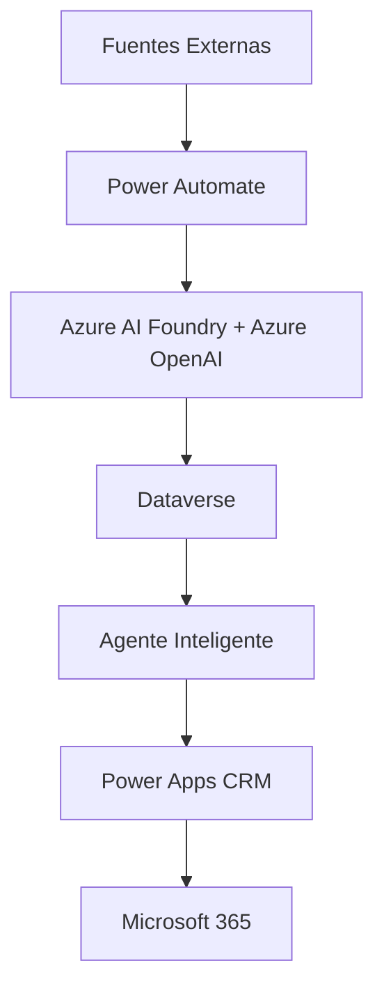
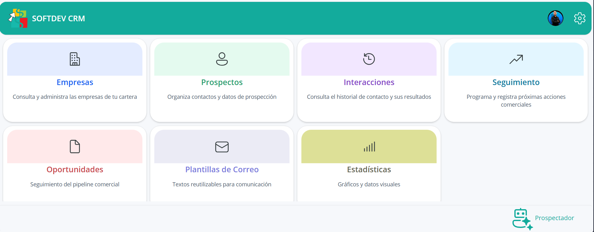
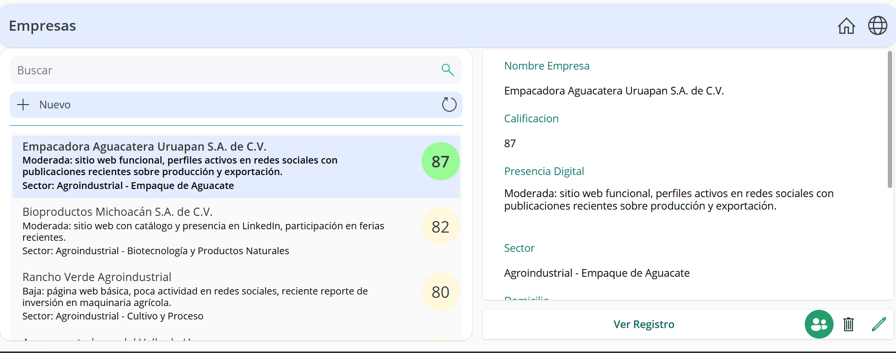
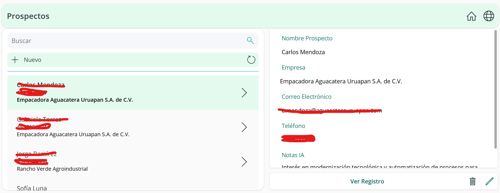
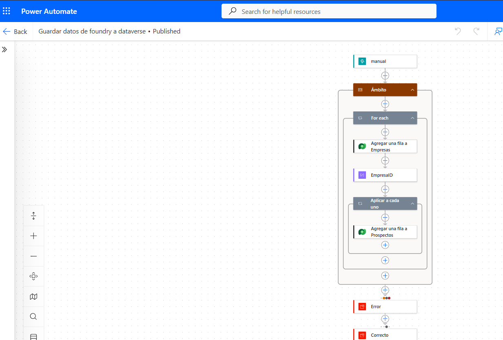

# Plataforma de Prospección Comercial Inteligente para Softdev

## Proyecto Integrador de Inteligencia Artificial Responsable

**Autor:** FRANCISCO JAVIER JACOBO MEZA

---

# 1. Introducción

Softdev es una empresa Partner de Microsoft que inició operaciones hace aproximadamente un año como un emprendimiento enfocado en consultoría, desarrollo de soluciones empresariales y soporte especializado en tecnologías Microsoft.

Como parte de su estrategia de crecimiento, requiere optimizar el proceso de identificación, análisis y seguimiento de clientes potenciales. Actualmente, estas actividades se realizan de forma manual y la información se encuentra distribuida en distintas plataformas como SharePoint, OneDrive, Teams y Outlook, dificultando una visión centralizada del proceso comercial.

Para resolver esta problemática, se propone el desarrollo de una plataforma de prospección comercial inteligente que combine las capacidades de Power Platform y los servicios de Inteligencia Artificial disponibles en Azure. 【1-63e2c7】

---

# 2. Objetivo

## Objetivo General

Diseñar e implementar una plataforma de prospección comercial inteligente para Softdev que automatice la identificación, análisis, clasificación y seguimiento de clientes potenciales mediante tecnologías de Microsoft Power Platform y servicios de Inteligencia Artificial de Azure.

## Objetivos Específicos

- Identificar empresas potencialmente interesadas en servicios tecnológicos.
- Recopilar información pública de organizaciones y contactos de negocio.
- Analizar automáticamente la información mediante Inteligencia Artificial.
- Calificar prospectos de acuerdo con criterios comerciales definidos.
- Generar recomendaciones y comunicaciones personalizadas.
- Centralizar la información comercial en una plataforma única.
- Facilitar la gestión de prospectos y oportunidades mediante una aplicación empresarial desarrollada en Power Apps.
- Reducir el esfuerzo manual asociado al proceso de prospección y seguimiento.

---

# 3. Arquitectura de la Solución

## Componentes Principales

| Componente | Función |
|------------|----------|
| Fuentes Externas | Obtención de información de empresas y prospectos |
| Power Automate | Automatización e integración de procesos |
| Dataverse | Repositorio central de información |
| Azure AI Foundry | Análisis y enriquecimiento de datos |
| Azure OpenAI | Procesamiento de lenguaje natural y razonamiento |
| Agente Inteligente | Interacción conversacional y análisis comercial |
| Power Apps | Gestión comercial y visualización de indicadores |
| Microsoft 365 | Comunicación y colaboración |

---

# 4. Restricciones y Supuestos

## Restricciones

- El proyecto será desarrollado por una sola persona.
- La disponibilidad para desarrollo será menor a 20 horas semanales.
- Se priorizará el uso de tecnologías del ecosistema Microsoft.
- La solución deberá operar en servicios compatibles con Microsoft Azure.
- El alcance corresponde a un Producto Mínimo Viable (MVP).

## Supuestos

- Se cuenta con acceso a una suscripción de Azure para el consumo de Azure OpenAI y Azure AI Foundry.
- Se dispone de acceso a Power Platform para el desarrollo y pruebas de la solución.
- Los datos analizados provendrán de fuentes públicas o autorizadas.
- Los usuarios finales tendrán acceso a Microsoft 365 y Power Apps.

---

# 5. Principios de Inteligencia Artificial Responsable

## Transparencia

Los usuarios conocerán cuándo una recomendación o análisis ha sido generado por Inteligencia Artificial.

## Privacidad y Seguridad

La información recopilada será protegida mediante controles de acceso y mecanismos de almacenamiento seguros.

## Equidad

Los criterios de análisis buscarán minimizar sesgos en la identificación y clasificación de prospectos.

## Supervisión Humana

La toma de decisiones comerciales permanecerá siempre bajo control humano.

## Confiabilidad

Toda recomendación generada deberá ser validada antes de ser utilizada en procesos comerciales.

## Responsabilidad

Las acciones automatizadas serán registradas y podrán ser auditadas en cualquier momento.

---

# 6. Plan de Trabajo

- **Fecha de inicio:** 14 de septiembre de 2026
- **Fecha de finalización:** 6 de noviembre de 2026

| Fase | Periodo | Entregable |
|--------|---------|------------|
| Preparación y análisis | 14 sep - 20 sep | Diseño de arquitectura |
| Diseño de la solución | 21 sep - 27 sep | Modelo funcional aprobado |
| Desarrollo MVP | 28 sep - 11 oct | CRM operativo |
| Integración de IA | 12 oct - 25 oct | Motor de IA implementado |
| Automatización comercial | 26 oct - 1 nov | Flujos automatizados |
| Pruebas y ajustes | 2 nov - 5 nov | MVP estabilizado |
| Puesta en producción | 6 nov | Solución funcional |

---

# 7. Solución Propuesta

La solución integra Power Platform y Azure AI para automatizar la prospección comercial mediante un proceso centralizado y escalable.

## Componentes de la Solución

### Azure AI Foundry

Responsable del análisis inteligente de prospectos, generación de resúmenes ejecutivos, identificación de oportunidades y recomendaciones comerciales.

### Azure OpenAI

Utilizado para el procesamiento de lenguaje natural, clasificación de información, evaluación de prospectos y generación de contenido personalizado.

### Power Automate

Orquesta la integración entre los servicios de Inteligencia Artificial y Dataverse, ejecutando procesos automáticos de captura, transformación y almacenamiento de información.

### Dataverse

Actúa como repositorio central para empresas, prospectos, análisis, resultados y actividades comerciales.

### Power Apps

Aplicación empresarial utilizada para:

- Administración de empresas.
- Gestión de prospectos.
- Seguimiento comercial.
- Consulta de información generada por IA.
- Visualización de indicadores y métricas mediante gráficos integrados.

### Microsoft 365

Servicios de productividad utilizados para colaboración, comunicación y gestión documental.

---

# 8. Beneficios Esperados

- Centralización de la información comercial.
- Reducción de tareas manuales de captura y seguimiento.
- Incremento en la velocidad de análisis de prospectos.
- Priorización inteligente de oportunidades comerciales.
- Mayor trazabilidad del proceso de ventas.
- Seguimiento comercial desde una única plataforma.
- Visualización de indicadores operativos y comerciales dentro de Power Apps.
- Escalabilidad para incorporar nuevos procesos de negocio en el futuro.

---

# 9. Tecnologías Utilizadas

- Microsoft Power Apps
- Microsoft Power Automate
- Microsoft Dataverse
- Microsoft 365
- Microsoft Teams
- Microsoft Outlook
- Microsoft Copilot
- Azure AI Foundry
- Azure OpenAI Service
---

# Evidencia visual

## Chatbot prospectador web

## Power Apps

### Menu principal

### Empresas

### Prospectos

### Estadisticas

## Automatizacion hacia Dataverse

---

# 10. Resultado Esperado

Al concluir el proyecto, Softdev contará con un Producto Mínimo Viable (MVP) capaz de:

1. Capturar información de prospectos.
2. Analizar empresas mediante Inteligencia Artificial.
3. Clasificar oportunidades comerciales.
4. Almacenar información estructurada en Dataverse.
5. Gestionar prospectos desde Power Apps.
6. Automatizar procesos mediante Power Automate.
7. Visualizar indicadores comerciales dentro de Power Apps.
8. Proporcionar recomendaciones inteligentes para la toma de decisiones.
9. Reducir significativamente el esfuerzo operativo asociado a la prospección comercial.

---

# Conclusión

La implementación de esta plataforma permitirá a Softdev modernizar su proceso comercial mediante tecnologías Microsoft y capacidades de Inteligencia Artificial Responsable. La solución proporcionará una base escalable para futuras iniciativas de automatización, análisis de datos y transformación digital, contribuyendo al crecimiento sostenible del negocio.
